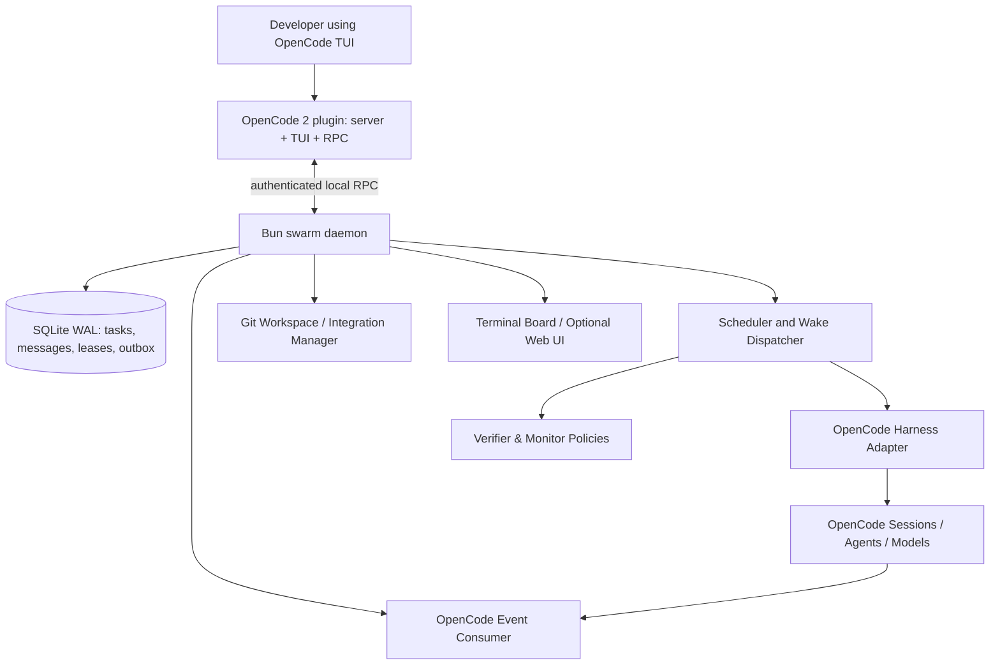
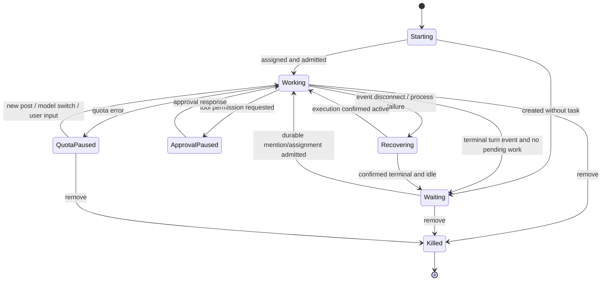
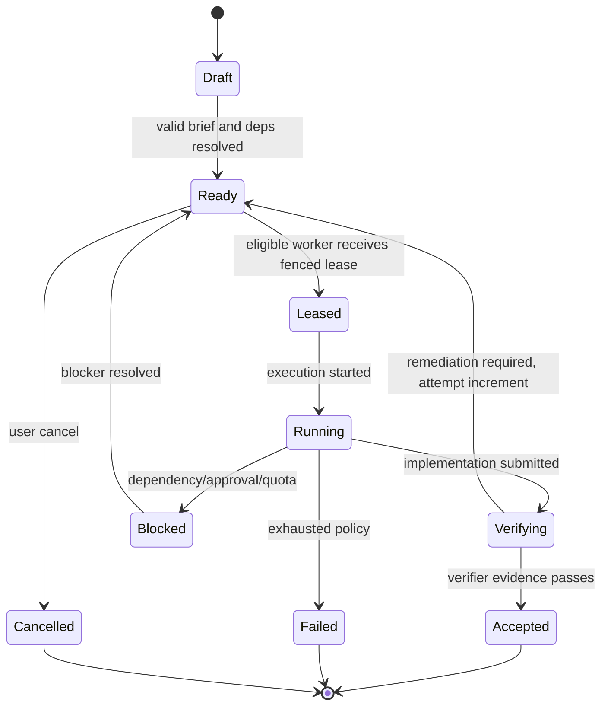

# OpenCode Swarm — Antigravity `/swarm` Behavioral Parity

**Implementation-ready technical design and phased delivery plan**  
**Version:** 1.0 (design baseline)  
**Prepared:** 2026-11-11  
**Target:** OpenCode 2.x plugin ecosystem, TypeScript + Bun, Windows 11 supported  
**Status:** Proposed architecture; API-compatibility and behavior probes required before production implementation

---

## 0. Executive decision

Build an **OpenCode 2.x native plugin** (`server` + `tui` + `rpc` parts) backed by a **long-lived local Bun swarm daemon**. Reuse native OpenCode sessions, agents, model/provider infrastructure and permissions. The daemon—not the coordinator model—owns durable messages, task scheduling, wake-ups, leases, recovery and Git integration. Codex is an optional later harness, not a dependency for parity.

**Parity goal:** match the *observable* Google Antigravity `/swarm` behavior documented as of 2026-11-11. It is not possible to promise byte-for-byte or internal implementation equivalence. Where documented behavior differs from the safer enhanced mode (e.g., shared workspace default), the default **`parity` profile** follows Antigravity; **`safe-coding` profile** adds strict worktrees and integration gates.

**Success definition:** one `/swarm` invocation creates a coordinator plus named independently running workers, verifier(s) and dormant monitor; all team communications are chronologically posted on one board; idle agents use zero inference tokens; mentions or new eligible work wake exactly the addressed sessions; the coordinator remains usable; results are verified and returned; the swarm can be inspected and steered from OpenCode without nonstop status polling.

### Non-goals for initial release

- Reimplement OpenCode model inference, editor, terminal, provider authentication or native agent definitions.
- Clone Google's proprietary internals, branding, UI assets, or undocumented protocols.
- Implement Antigravity `/boost` or `/teamwork`; those are separate product modes.
- Assume `session.idle` or an OpenCode SDK `wait()` call guarantees durable task completion.
- Promise arbitrary hooks exist in OpenCode v1 and v2 simultaneously.
- Auto-push branches or make remote Git changes without explicit opt-in.

---

## 1. Sources, evidence classes and version policy

### Primary references

1. Google Antigravity official Swarm guide: https://antigravity.google/docs/swarm/
2. Antigravity slash commands: https://antigravity.google/docs/slash-commands/
3. OpenCode 2 plugin overview: https://opencode.ai/v2/docs/build/plugins/
4. OpenCode 2 plugin server API: https://opencode.ai/v2/docs/build/plugins/server/
5. OpenCode 2 TUI plugin API: https://opencode.ai/v2/docs/build/plugins/cli/
6. OpenCode 2 RPC plugin API: https://opencode.ai/v2/docs/build/plugins/rpc/
7. OpenCode embedded SDK: https://opencode.ai/docs/build/sdk
8. OpenCode API/event specification: https://opencode.ai/docs/api
9. OpenCode v1 plugin docs (for compatibility only): https://docs.opencode.ai/docs/plugins/
10. OpenCode v1 SDK (for compatibility only): https://docs.opencode.ai/docs/sdk/

### Evidence labels used below

- **[G-DOC]**: directly documented Antigravity behavior.
- **[OC2-DOC]**: documented OpenCode 2 API or plugin hook.
- **[DESIGN]**: ours to implement; not an OpenCode/Google API.
- **[PROBE]**: requires executable confirmation on the actual pinned OpenCode build.

**Version warning:** OpenCode's legacy `@opencode-ai/plugin`, `@opencode-ai/sdk` and `plugin` (singular) JSON examples differ from OpenCode 2 `@opencode/plugin`, `@opencode/sdk` and `plugins` (plural). Do not mix generations. Record the exact `opencode --version`, package versions, `bun --version`, API schema checksum, and `git rev-parse HEAD` for the tested distribution before coding adapters. Existing installations may still use v1-compatible configurations. No migration is authorized in the first milestone.

---

## 2. Antigravity behavioral parity matrix

| ID | Antigravity documented behavior | Required OpenCode behavior | Evidence | Acceptance proof |
|---|---|---|---|---|
| PAR-01 | `/swarm <task>` converts current conversation to coordinator | Current session becomes lead; swarm association persisted | [G-DOC] | One command; current session remains primary interface |
| PAR-02 | Coordinator names swarm and divides non-colliding work | Deterministic plan records title, membership, path ownership | [G-DOC] | Board shows assignment for every worker |
| PAR-03 | Named workers and numbered groups | `@api`, `@tests`, `@fix-1..4`, group membership | [G-DOC] | Unique names, mentions resolve unambiguously |
| PAR-04 | Each worker starts a clean conversation | Distinct session ID and no unrequested transcript inheritance | [G-DOC] | Context inspection confirms isolation |
| PAR-05 | Every assignment is a public brief with ownership/exclusions/done criteria | Immutable `brief` board event before dispatch | [G-DOC] | Chronological feed contains exact brief |
| PAR-06 | Verifier for approximately 2–4 implementation workers | Planner suggests `ceil(coders/3)` independent verifiers | [G-DOC] | 8 coders → default 3 verifiers, overridable |
| PAR-07 | Verifier reads diffs, runs tests, reports defects for correction | Review/test evidence objects and worker remediation loop | [G-DOC] | Real failing test causes targeted rework |
| PAR-08 | Public-only worker communication, ordered shared board | Durable sequenced posts; no private worker-to-worker channel | [G-DOC] | Two workers see identical order |
| PAR-09 | `@name`, `@group`, `@all` mention semantics | Recipient resolver and durable fanout | [G-DOC] | Mention wake targets verified |
| PAR-10 | `working`, `waiting`, `killed` member states | Expose those three parity states | [G-DOC] | State transitions and UI match |
| PAR-11 | Waiting member emits zero inference calls | No queued prompt, generation or model call when waiting | [G-DOC] | Provider request counter remains unchanged |
| PAR-12 | Mentioned waiting member wakes automatically | One durable wake event causes one resumed turn | [G-DOC] | Wake without lead polling |
| PAR-13 | Coordinator also sleeps while workers run | Lead resumes only on messages / decision signals | [G-DOC] | No repeated `status` model calls |
| PAR-14 | Dormant `@monitor` intervenes only if everybody quiet and work remains | Policy-driven global-quiescence detector | [G-DOC] | No monitor inference during progress; one intervention after threshold |
| PAR-15 | Coordinator delegates; does not implement technical work | Lead tool/permission policy excludes coding writes | [G-DOC] | Lead cannot edit protected repo |
| PAR-16 | All workers use lead model by default, with optional overrides and switching of waiting workers | Resolve native model refs; switch model without resetting session | [G-DOC] | Switch waiting worker then continue same conversation |
| PAR-17 | Shared workspace by default; optional isolated working copies | `parity` uses shared workspace; `safe-coding` uses per-task worktrees | [G-DOC] | Both strategies tested |
| PAR-18 | Before removing isolated worker, changes must be landed | Refuse destructive cleanup with unintegrated diff | [G-DOC] | Unmerged worker cannot silently lose changes |
| PAR-19 | Killed worker cannot be revived | Tombstone member ID; new worker gets new ID | [G-DOC] | Wake on killed ID rejected |
| PAR-20 | Quota exhaustion pauses without automatic retry on refresh | Separate `quota_paused` internal state; user/post/model-switch wake policy | [G-DOC] | No retry loop during quota exhaustion |
| PAR-21 | Swarm board with roster, ordered posts, read markers, follow/search/filter | Terminal board parity | [G-DOC] | Board interaction test suite |
| PAR-22 | Graph of directed mentions and chronological replay | Derive graph from ordered immutable board posts | [G-DOC] | Replay weights equal post counts |
| PAR-23 | User can address one worker privately; worker-peer posts remain public | User-to-worker direct session prompt, explicitly not board-posted | [G-DOC] | User direct input absent from public board |
| PAR-24 | `/agents` can open worker conversation | Native session links / navigation | [G-DOC] | Selected worker opens matching session |
| PAR-25 | Coordinator reports completion | Final summary with accepted evidence, open issues, working-tree status | [G-DOC] | Lead emits one final report |

**Parity boundary:** Antigravity's branded GUI pane, exact keybinding capture and status-row placement may be impossible in a specific OpenCode TUI/desktop version; provide the same interactions using documented TUI plugin slots/routes/RPC or an external terminal board and explicitly label any visual deviation. Pixel parity is out of scope.

---

## 3. Architecture



### Responsibility boundaries

**Plugin** — registers `/swarm`, `swarm_*` tools, public hooks, native agent discovery, session navigation, TUI board and RPC. It never stores authoritative swarm state in process memory.

**Daemon** — authoritative task/agent/message store, admission control, ordered events, leases, wake-up routing, recovery, throttling, policy and audit. It is independently started/stopped and survives an OpenCode TUI exit.

**Harness adapter** — creates/controls native sessions, switches agents/models, submits one turn, observes completion/failure and validates model/permissions. It must remain replaceable so the daemon can later support Codex.

**Git manager** — owns worktree creation/cleanup, path scopes, merge staging, verification after merge and canonical integration; no worker can implicitly claim a merge.

**Board** — projection of immutable journal entries, never a separate source of truth.

### Execution profiles

- **`parity` (default for parity tests):** shared workspace, on-demand isolated copies at coordinator request, native session agent defaults, no forced integration review beyond documented verifier behavior.
- **`safe-coding` (recommended for real projects):** separate Git worktree per coding task, leader write restrictions, strict verification, integration mutex and manual approval for risky operations.

No profile may weaken native OpenCode security/permission policy silently.

---

## 4. Exact API inventory and probes

### 4.1 OpenCode 2 plugin package

**Documented package structure [OC2-DOC]:**

```json
{
  "name": "@example/opencode-swarm",
  "type": "module",
  "exports": {
    ".": "./src/index.ts",
    "./tui": "./src/tui.tsx",
    "./rpc": "./src/rpc.ts"
  },
  "dependencies": {
    "@opencode/plugin": "<PINNED_COMPATIBLE_VERSION>"
  }
}
```

The `gui-experimental` part is optional and delayed. **Do not paste a literal version placeholder into a runnable package manifest.** Set this only after an actual compatible version is determined by M0.

**[OC2-DOC] Plugin registration:**

```ts
import { Plugin } from "@opencode/plugin";
export default Plugin.define({
  id: "swarm",
  async setup(ctx) {
    // Register command/tool hooks, start event forwarding, return cleanup.
  },
});
```

**[OC2-DOC] Load path:** `.opencode/plugins/` for local projects, or `plugins: ["@example/opencode-swarm"]` in a v2 `opencode.jsonc`.

### 4.2 OpenCode 2 server hooks and methods

| Area | Documented method / event | Our usage | Probe |
|---|---|---|---|
| Command transform | `ctx.command.transform(editor => editor.add({name, description, execute}))` | `/swarm` command, input capture | Verify command is exposed in target TUI and parsing of `/swarm board` |
| Command listing | `ctx.command.list()` | Discover command conflicts | Verify current command names |
| Session creation | `ctx.session.create({ title })` | New worker context | Verify location/worktree binding |
| Session read | `ctx.session.get({ sessionID })` | Reconcile state | Verify metadata and lifecycle |
| Session transcript | `ctx.session.context({ sessionID })` | Recover recent context | Check size, pagination and cost |
| Session native agent | `ctx.session.switchAgent({ sessionID, agent })` | Preserve native agent ID | Verify agent lookup and permission behavior |
| Model change | `ctx.session.switchModel({ sessionID, model: {providerID,id} })` | Model overrides | Validate provider ID versus friendly label |
| Prompt admission | `ctx.session.prompt({ sessionID, text, delivery? })` | Queue wake-ups / tasks | Validate `queue` vs `steer` and completed-turn evidence |
| Session cancel | `ctx.session.interrupt({ sessionID, continue:false })` | Cancellation | Verify it interrupts active tools safely |
| Session wait | `ctx.session.wait({ sessionID })` | Optional signal, not durable truth | Verify semantics and restart behavior |
| Ordered event stream | `ctx.event.subscribe({signal})` | Session events to daemon | Verify event payload/schema and reconnection |
| Permission rules | `ctx.permission.rules({sessionID, permissions})` | Sandbox canonical repo | Verify last-match-wins and child inheritance |
| Pending approvals | `ctx.permission.list({sessionID})` and `reply(...)` | Surface approvals, never auto-approve | Validate exact request ID lifecycle |
| Prompt interception | `ctx.session.hook("prompt", handler)` | Enforce provenance/correlation metadata if needed | Guard against multiple invocations |
| Agent transform | `ctx.agent.transform(...)` | Optional agent metadata/capability decoration | Do not mutate native agent by default |

The prompt hook is **not an exactly-once side-effect boundary**; do not allocate tasks or send messages inside it. A user prompt is not proof that an inference turn finished. Use the daemon journal plus execution events. See official v2 server docs.

**[OC2-DOC] OpenCode events:** the public API documents `session.execution.started`, `session.execution.succeeded`, `session.execution.failed`, `session.execution.interrupted`, `session.inbox.enqueued`, `session.inbox.delivered`, `session.inbox.delivery.changed`, `session.tool.*`, `permission.asked`, `permission.replied`, `session.usage.updated` and more. The event stream is explicitly **volatile**; a slow reader can overflow, and events missed during disconnection cannot be replayed by the stream alone. **Therefore our daemon must durably record intents before acting and reconcile snapshots after reconnection.**

### 4.3 SDK host as an alternative execution adapter

The OpenCode embedded SDK documentation shows **[OC2-DOC]**:

```ts
import { OpenCode } from "@opencode/sdk";
await using host = await OpenCode.create();
const session = await host.sessions.create({ location: { directory: "/workspace" } });
await host.sessions.prompt({ sessionID: session.id, text: "Review changes" });
for await (const event of host.events.subscribe()) {
  // Forward observed events to daemon.
}
```

**Do not run separate embedded hosts for each worker by default.** First prove that a single owned host can create distinct sessions with the correct project location and worktree and that it does not conflict with the user's OpenCode server. Plugin/server-session APIs remain the preferred initial integration.

**Worktree SDK [OC2-DOC]:** `host.worktree.create({projectID,name})`, `host.worktree.refresh({projectID})` and `host.worktree.remove({projectID,directory,force:false})`. This API requires `projectID`; confirm whether the plugin context exposes the corresponding worktree API or whether the runtime should use `git worktree` directly.

### 4.4 OpenCode 2 TUI and RPC

The current OpenCode v2 plugin overview documents distinct `./tui` and `./rpc` exports. M0 must typecheck the installed TUI plugin SDK and RPC transport against its **actual published type definitions**, then implement:

- A discoverable `/swarm` action;
- `/swarm board` navigation or separate `swarm board` CLI fallback;
- roster/post/detail panes, read markers, filters and follow;
- worker-session navigation;
- client↔server RPC with an explicitly versioned message schema.

**[PROBE]** Exact TUI registration, shortcut interception (`Alt+S`), and RPC method names are intentionally **not asserted here** until tested against the pinned release. Avoid undocumented terminal input interception. A functional standalone Bun terminal board is the fallback acceptance target if native board embedding is unsupported.

### 4.5 Codex adapter (future)

Codex support stays behind `CodingHarness`; validate official SDK/App Server APIs independently at M7. Do not implement the daemon by shelling out to undocumented Codex commands or assume a Codex MCP server exposes full native swarm controls.

### 4.6 Required executable compatibility probes (M0)

1. Install clean pinned OpenCode 2.x and `@opencode/plugin`; compile a no-op server plugin.
2. Register command and verify `/swarm` and `/swarm board` argument semantics in TUI.
3. Enumerate available native agents and their effective models/permissions.
4. Create two independent sessions, select two native agent IDs, prompt concurrently.
5. Confirm true concurrency by overlapping `session.execution.started` → terminal execution events.
6. Send prompt to waiting session and confirm **one** new model turn.
7. Capture all event shapes and detect which IDs correlate prompt admission and execution completion.
8. Reconnect event listener mid-turn; reconcile via session snapshot; prove duplicate completion is prevented.
9. Change model for waiting session; verify history is retained.
10. Cancel tool-running worker and validate final failure/interruption signal.
11. Enforce deny rules for canonical worktree and verify denied edit/bypass behavior.
12. Verify plugin process exit/reload while daemon continues running.

If a probe fails, record the finding and use a documented alternative or change the milestone; never patch undocumented OpenCode internals as a shortcut.

---

## 5. Public protocol and TypeScript contracts

Define contracts in `packages/protocol` using **Zod** as the single runtime-validation source; derive TypeScript types from schemas. Wire protocol must carry `schemaVersion`, `swarmId`, `correlationId`, and idempotency keys where applicable.

```ts
export type MemberRole = "coordinator" | "coder" | "verifier" | "monitor" | "researcher";
export type PublicMemberState = "working" | "waiting" | "killed";
export type InternalMemberState = PublicMemberState | "starting" | "quota_paused" | "approval_paused" | "recovering";
export type TaskState = "draft" | "ready" | "leased" | "running" | "verifying" | "blocked" | "accepted" | "failed" | "cancelled";
export type PostKind = "brief" | "message" | "question" | "progress" | "result" | "verification" | "monitor" | "done" | "system";

export interface Swarm {
  id: string;
  title: string;
  coordinatorSessionId: string;
  projectRoot: string;
  mode: "parity" | "safe-coding";
  status: "planning" | "running" | "paused" | "completing" | "completed" | "failed" | "cancelled";
  createdAt: string;
  updatedAt: string;
  revision: number;
}
export interface Member {
  id: string;
  swarmId: string;
  name: string;
  groups: string[];
  role: MemberRole;
  nativeAgentId: string;
  sessionId: string;
  model: { providerID: string; id: string };
  publicState: PublicMemberState;
  internalState: InternalMemberState;
  generation: number;
  lastActivityAt: string;
  killedAt: string | null;
}
export interface Task {
  id: string;
  swarmId: string;
  title: string;
  brief: string;
  ownerId: string | null;
  deps: string[];
  ownedPaths: string[];
  forbiddenPaths: string[];
  acceptanceCriteria: string[];
  state: TaskState;
  attempt: number;
  generation: number;
  worktreePath: string | null;
  baseCommit: string | null;
  resultEvidenceIds: string[];
}
export interface BoardPost {
  id: string;
  swarmId: string;
  sequence: number;
  authorMemberId: string | null; // null = system
  kind: PostKind;
  body: string;
  mentions: string[]; // canonical member IDs, not untrusted text
  groupMentions: string[];
  mentionAll: boolean;
  createdAt: string;
  idempotencyKey: string;
  relatedTaskId: string | null;
}
export interface WakeIntent {
  id: string;
  swarmId: string;
  memberId: string;
  memberGeneration: number;
  reason: "mention" | "assigned_task" | "verifier_request" | "monitor_intervention" | "user_direct";
  postSequence: number | null;
  taskId: string | null;
  payloadHash: string;
  state: "queued" | "admitted" | "observed_running" | "succeeded" | "failed" | "cancelled";
  attempts: number;
  createdAt: string;
}
export interface VerificationEvidence {
  id: string;
  taskId: string;
  commitSha: string | null;
  command: string;
  cwd: string;
  exitCode: number;
  startedAt: string;
  finishedAt: string;
  stdoutArtifactId: string;
  stderrArtifactId: string;
  executorMemberId: string;
}
```

**Invariant:** board messages among swarm members are public; only *user → specific worker* input may be private, per Antigravity docs. All mentions are parsed by a robust lexer, not by simple string `.includes()`. Resolve escaped `@@`, code fences, unknown names, and group namespace collisions deterministically; reject ambiguous mentions.

### Runtime ↔ plugin HTTP/RPC operations [DESIGN]

| Method | Endpoint | Function |
|---|---|---|
| `POST` | `/v1/swarms` | Create swarm from coordinator session and requirement |
| `GET` | `/v1/swarms/:id` | Read swarm snapshot |
| `POST` | `/v1/swarms/:id/members` | Add named member |
| `POST` | `/v1/swarms/:id/tasks` | Create task with dependencies and brief |
| `POST` | `/v1/swarms/:id/posts` | Append public board post transactionally |
| `GET` | `/v1/swarms/:id/posts?after=` | Board replay/pagination |
| `POST` | `/v1/swarms/:id/pause` | Halt new dispatch |
| `POST` | `/v1/swarms/:id/resume` | Resume dispatch |
| `POST` | `/v1/swarms/:id/cancel` | Durable cancel intent |
| `POST` | `/v1/swarms/:id/events/ingest` | OpenCode event ingress |
| `GET` | `/v1/swarms/:id/events/stream` | SSE board projections |
| `GET` | `/healthz` | Liveness and schema version |

Require loopback-only binding by default, bearer token from locally stored secret, origin restrictions, input validation and a bounded body size. Do not expose daemon on `0.0.0.0` without explicit authenticated configuration.

### OpenCode LLM-facing tools [DESIGN]

`swarm_create`, `swarm_add_member`, `swarm_assign`, `swarm_post`, `swarm_read_board`, `swarm_list_members`, `swarm_list_tasks`, `swarm_model_switch`, `swarm_remove_member`, `swarm_finish`, `swarm_cancel`.

**Tool restrictions:** only coordinator may allocate/kill members, assign ownership or finalize; workers may post and update their own task; verifiers may publish verification evidence; monitor may request attention but not edit code. Route all modifications via server-validated role policy, not prompt instructions alone.

---

## 6. Durable SQLite schema

Bun `bun:sqlite` / SQLite in WAL mode is sufficient for single-machine v1. Enable foreign keys, busy timeout, migrations and one authoritative write owner. A future PostgreSQL backend is an adapter, not a milestone-1 prerequisite.

```sql
PRAGMA journal_mode = WAL;
PRAGMA foreign_keys = ON;

CREATE TABLE swarms (
  id TEXT PRIMARY KEY,
  title TEXT NOT NULL,
  coordinator_session_id TEXT NOT NULL,
  project_root TEXT NOT NULL,
  mode TEXT NOT NULL CHECK (mode IN ('parity','safe-coding')),
  status TEXT NOT NULL,
  revision INTEGER NOT NULL DEFAULT 0,
  created_at TEXT NOT NULL,
  updated_at TEXT NOT NULL
);
CREATE TABLE members (
  id TEXT PRIMARY KEY,
  swarm_id TEXT NOT NULL REFERENCES swarms(id),
  name TEXT NOT NULL,
  role TEXT NOT NULL,
  native_agent_id TEXT NOT NULL,
  session_id TEXT NOT NULL UNIQUE,
  model_provider_id TEXT NOT NULL,
  model_id TEXT NOT NULL,
  public_state TEXT NOT NULL,
  internal_state TEXT NOT NULL,
  generation INTEGER NOT NULL DEFAULT 1,
  last_activity_at TEXT NOT NULL,
  killed_at TEXT,
  UNIQUE (swarm_id, name)
);
CREATE TABLE member_groups (
  swarm_id TEXT NOT NULL,
  member_id TEXT NOT NULL REFERENCES members(id),
  group_name TEXT NOT NULL,
  PRIMARY KEY (swarm_id, member_id, group_name)
);
CREATE TABLE tasks (
  id TEXT PRIMARY KEY,
  swarm_id TEXT NOT NULL REFERENCES swarms(id),
  owner_id TEXT REFERENCES members(id),
  title TEXT NOT NULL,
  brief TEXT NOT NULL,
  state TEXT NOT NULL,
  attempt INTEGER NOT NULL DEFAULT 0,
  generation INTEGER NOT NULL DEFAULT 1,
  owned_paths_json TEXT NOT NULL,
  forbidden_paths_json TEXT NOT NULL,
  acceptance_json TEXT NOT NULL,
  base_commit TEXT,
  worktree_path TEXT,
  created_at TEXT NOT NULL,
  updated_at TEXT NOT NULL
);
CREATE TABLE task_deps (
  task_id TEXT NOT NULL REFERENCES tasks(id),
  depends_on_id TEXT NOT NULL REFERENCES tasks(id),
  PRIMARY KEY(task_id, depends_on_id),
  CHECK(task_id <> depends_on_id)
);
CREATE TABLE posts (
  id TEXT PRIMARY KEY,
  swarm_id TEXT NOT NULL REFERENCES swarms(id),
  sequence INTEGER NOT NULL,
  author_member_id TEXT REFERENCES members(id),
  kind TEXT NOT NULL,
  body TEXT NOT NULL,
  related_task_id TEXT REFERENCES tasks(id),
  idempotency_key TEXT NOT NULL,
  created_at TEXT NOT NULL,
  UNIQUE(swarm_id, sequence),
  UNIQUE(swarm_id, idempotency_key)
);
CREATE TABLE post_recipients (
  post_id TEXT NOT NULL REFERENCES posts(id),
  member_id TEXT NOT NULL REFERENCES members(id),
  PRIMARY KEY(post_id, member_id)
);
CREATE TABLE wake_intents (
  id TEXT PRIMARY KEY,
  swarm_id TEXT NOT NULL REFERENCES swarms(id),
  member_id TEXT NOT NULL REFERENCES members(id),
  member_generation INTEGER NOT NULL,
  reason TEXT NOT NULL,
  post_sequence INTEGER,
  task_id TEXT REFERENCES tasks(id),
  payload_hash TEXT NOT NULL,
  state TEXT NOT NULL,
  attempts INTEGER NOT NULL DEFAULT 0,
  created_at TEXT NOT NULL,
  updated_at TEXT NOT NULL,
  UNIQUE(member_id, member_generation, reason, post_sequence, task_id)
);
CREATE TABLE leases (
  resource_key TEXT PRIMARY KEY,
  holder TEXT NOT NULL,
  fencing_token INTEGER NOT NULL,
  expires_at TEXT NOT NULL
);
CREATE TABLE outbox (
  id TEXT PRIMARY KEY,
  kind TEXT NOT NULL,
  aggregate_id TEXT NOT NULL,
  payload_json TEXT NOT NULL,
  delivered_at TEXT,
  attempts INTEGER NOT NULL DEFAULT 0,
  created_at TEXT NOT NULL
);
CREATE TABLE inbox_dedupe (
  source TEXT NOT NULL,
  external_event_id TEXT NOT NULL,
  received_at TEXT NOT NULL,
  PRIMARY KEY(source, external_event_id)
);
CREATE TABLE artifacts (
  id TEXT PRIMARY KEY,
  swarm_id TEXT NOT NULL REFERENCES swarms(id),
  task_id TEXT REFERENCES tasks(id),
  kind TEXT NOT NULL,
  sha256 TEXT NOT NULL,
  file_path TEXT NOT NULL,
  created_at TEXT NOT NULL
);
CREATE TABLE verification_evidence (
  id TEXT PRIMARY KEY,
  task_id TEXT NOT NULL REFERENCES tasks(id),
  executor_member_id TEXT NOT NULL REFERENCES members(id),
  command TEXT NOT NULL,
  cwd TEXT NOT NULL,
  exit_code INTEGER NOT NULL,
  commit_sha TEXT,
  stdout_artifact_id TEXT NOT NULL REFERENCES artifacts(id),
  stderr_artifact_id TEXT NOT NULL REFERENCES artifacts(id),
  started_at TEXT NOT NULL,
  finished_at TEXT NOT NULL
);
CREATE INDEX ix_posts_swarm_seq ON posts(swarm_id, sequence);
CREATE INDEX ix_task_state ON tasks(swarm_id, state);
CREATE INDEX ix_wake_state ON wake_intents(state, created_at);
CREATE INDEX ix_outbox_pending ON outbox(delivered_at, created_at);
```

**Migration hardening before release:** update `CHECK` constraints for every state enum; add `member_read_cursors`, `session_executions`, `usage_ledger`, `permission_approvals`, `task_attempts`, and `integration_runs` during the relevant milestones. Use `BEGIN IMMEDIATE` for board sequence allocation; do not use `MAX(sequence)+1` outside a transaction.

**Sequence allocation algorithm:** in one transaction, read `swarms.revision`, increment it, insert `posts.sequence = revision`, resolve recipients against an immutable membership snapshot, insert `post_recipients` and corresponding `wake_intents`, append outbox entries, commit. A crash either persists all or none.

**Idempotency caveat:** SQLite `UNIQUE` treats NULLs as distinct; wake dedupe must use a normalized non-null delivery key (e.g., `sha256(memberId|generation|reason|postIdOr0|taskIdOr0)`) with its own `UNIQUE` index. The illustrative schema's nullable composite constraint alone is insufficient—implement and test the normalized key in migration 002 before M2.

---

## 7. State machines and transition guards

### 7.1 Member state



**Public-state projection:** `Working => working`, `Waiting => waiting`, `Killed => killed`; exceptional states are presented as supplementary labels (`quota paused`, `approval required`, `recovering`) rather than implying Antigravity has extra standard public states.

### 7.2 Task state



### 7.3 Wake-intent state

`queued → admitted → observed_running → succeeded | failed | cancelled`; retain intent record permanently for audit. Do not equate `admitted` with successful generation. An expired lease only enables recovery after checking whether the corresponding OpenCode session is actually active.

### Guards

- Killed member cannot receive wake intent, switch model or regain ownership.
- A member has at most one actively admitted turn at a time. New mentions coalesce into an ordered inbox batch.
- Duplicate event or retry with identical idempotency key cannot create a second turn.
- Every scheduler mutation carries task/member `generation` and/or monotonically increasing fencing token.
- Tasks cannot start until all required dependencies are accepted; reject cycles at task creation using DFS/topological validation.
- Worker cannot submit accepted status for its own verification gate.
- Final acceptance requires real evidence and integration policy satisfaction.

---

## 8. Scheduling, concurrency and wake-ups

### Concurrency model

1. **One actor per member**: serial input inbox + maximum one active inference turn.
2. **Many independent actors**: 8–12 workers can execute concurrently across distinct native OpenCode sessions.
3. **Global admission semaphore**: default 8 coding turns; separate lane for coordinator, verifier(s) and monitor; configurable hard cap.
4. **Provider quotas**: per-model/provider token/request concurrency limit; throttle queues without spending inference tokens.
5. **Repository resource locks**: path ownership at task admission and integration lock for canonical merge; never claim file locking alone prevents all logical conflicts.
6. **Fairness**: FIFO by eligibility time within priority band; avoid starvation by bounded priority aging.
7. **Task reservation**: `ready → leased` atomic DB transition, fencing token, heartbeat, timeout and explicit recovery.
8. **Backpressure**: bounded pending wake queue per member, batch posts, surface overload; never drop committed board posts.

**Lead anti-polling invariant:** when no member is specifically addressed and no decision threshold is reached, do not send a prompt to the coordinator. UI status requests are served from SQLite projections. `session.idle` is an observed state, not a periodic reminder to ask the model to check tasks.

### Wake dispatcher pseudocode

```ts
async function dispatchWake(intentId: string) {
  const claim = store.claimWakeIntent(intentId); // transaction + fencing token
  if (!claim) return;
  const member = store.getMember(claim.memberId);
  if (member.internalState === "killed" || member.generation !== claim.memberGeneration) {
    store.cancelWake(intentId, "stale-generation");
    return;
  }
  if (store.hasLiveExecution(member.id)) {
    store.deferWake(intentId); // serialize and batch; never overlap turns
    return;
  }
  const payload = store.composeUnreadMentionsAndTask(member.id);
  const admission = await harness.submitTurn({
    sessionId: member.sessionId,
    text: payload,
    delivery: "queue",
    externalId: intentId,
  });
  // 'externalId' is OUR adapter contract, not a documented OpenCode argument.
  // Implement mapping and reconciliation in harness adapter, not direct API pass-through.
  store.recordAdmission(intentId, admission);
}
```

**Crash window:** OpenCode prompt admission and SQLite acknowledgement cannot be made atomically. Exactly-once model execution is therefore **not guaranteed** without a documented server-side idempotency token. Reconcile session inbox/executions and record a deduplication marker in prompt metadata where supported. If an ambiguous admission cannot be proven absent, quarantine it for review rather than blindly replaying.

### Board mention behavior

- `@name` → exact live member ID.
- `@group` → snapshot of live group members at post commit.
- `@all` → snapshot of all non-killed members except author by default (configurable; match observed Antigravity tests).
- Posts without mentions remain visible but do not wake members merely because a new post exists.
- Direct user-to-worker message → session-specific prompt; not a public board post.
- Quota-paused members: do not auto-retry on elapsed time; resume only on documented triggers.

### Monitor algorithm

Monitor is a **scheduler policy**, not a continuously running inference session. Track the latest meaningful task/board/execution progress timestamp. After `quietThreshold` (default **120 seconds**, a proposed value, not claimed Antigravity default), if unfinished tasks exist and *all live members are inactive/waiting*, create one `monitor_intervention` wake intent. The dormant monitor posts a diagnosis or mentions the blocked worker/coordinator. Guard with cool-down (`300s` proposed), at most one outstanding intervention per quiet epoch. Do not wake monitor when a long-running build is actively executing; require execution heartbeat or explicit timeout policy.

---

## 9. Agent identity, capabilities, security and workspace

### Native agent reuse

- Discover native OpenCode agents from official config/agent interfaces; retain agent IDs, system instructions, tools, model and permissions.
- Store `nativeAgentId` and session binding, not copies of large `AGENTS.md` text in the board.
- Only add a small **swarm-role overlay** (public board rules, ownership brief, stop/done protocol) that does not override native safety permissions.
- Enforce role controls in daemon AND plugin tool authorization. A prompt-only instruction such as “coordinator never edits” is inadequate.
- Support user installations with multiple local/custom agents. Unknown IDs fail visibly.
- Preserve existing OpenCode configuration and Ensemble installation unmodified during trial.

### Security profiles

**Parity profile:** follows documented shared workspace behavior, but warns before simultaneous edits to overlapping paths.

**Safe-coding profile:** create `git worktree add` under controlled per-task directories, unique branch per task, deny write to canonical checkout, require verifier approval, integrate with a single process holding canonical lock, run tests after merge, preserve failed worktrees for diagnosis. Use rollback via temp integration branch; do not reset user's working tree.

**Windows constraints:** normalize drive-letter and UNC paths, detect NTFS case-insensitive aliases and symlinks/junctions, avoid destructive cleanup outside configured workspace root. Never trust a text path from an agent as authorization; validate resolved paths.

**Secrets:** no full credentials in board posts, tool logs or trace payloads. Redact `.env`, tokens and API keys. Confirm opt-in before sending private code to providers with training/data-retention terms.

**Permissions:** apply OpenCode session-scoped rules after agent rules only when documented; verify last-match-wins, inherited child permissions and test engineer's actual shell access through a real tool execution. Reject silent fallback when an agent lacks `shell` or edit tools.

---

## 10. Git verification and controlled integration

**Parity mode** can use a shared checkout to mirror Antigravity. For serious concurrent coding, recommend `safe-coding`:

1. Record clean/dirty working-tree baseline; never modify unrelated user changes.
2. Assign task-owned files and base SHA.
3. Create isolated worktree and branch under runtime-managed root.
4. Execute native agent only in that task's workspace.
5. Capture diff, build logs, tests and changed-file manifest.
6. Give verifier read access to diff/branch and actual test command execution.
7. If failed, post public feedback to original worker, create targeted remediation attempt.
8. On acceptance, integrate under single repo lock to temporary integration branch (no blind force/reset).
9. Run post-integration tests; on failure stop and retain evidence without advancing canonical branch.
10. After success, commit/merge according to configured policy; report exact SHA and uncommitted status.

Do not let workers or lead independently merge under concurrency. A completion report is not evidence that a branch is integrated.

---

## 11. Terminal UX and parity board

### CLI/commands

- `/swarm <requirement>` — current session becomes coordinator.
- `/swarm board` — full-screen live board (via TUI plugin if supported; otherwise `bunx opencode-swarm board`).
- `/swarm status` — zero-token database snapshot.
- `/swarm agents` — list members and open native conversations.
- `/swarm stop` — cancel, with clear worktree preservation policy.
- `/swarm pause` / `/swarm resume` — scheduler gate.
- `@worker <text>` — user-to-worker private steer only if OpenCode TUI exposes a supported routing hook; otherwise `/swarm message @worker ...` fallback.

### Board panes

- **Roster**: coordinator first; active/standing-by/retired; state, model, last post, latest task.
- **Posts**: globally ordered sequence, author, recipients, timestamp, unread divider, member filter and search.
- **Message**: full selected post.
- **Graph**: directed mention edges, counts, chronological post replay (P1).
- **Follow**: opt-in auto-scroll.
- **Approvals**: number pending and link to native approval workflow; never bypass it.

Target Antigravity CLI keys: `Alt+S` open board where supported; board navigation `j/k`, arrows, `g/G`, Enter, Space, `[ ]`, `f`, `p`, Tab/Shift+Tab, `z`, `o`, Esc, `q`. For unavailable global shortcuts, document equivalent supported key bindings instead of undocumented interception.

### User-visible status line

`Swarm: 8 coding | 3 verifying | 1 monitor waiting | 42 posts | 4 blocked` (illustrative). If no OpenCode TUI slot can render it, provide `swarm status --watch` as a fallback without model requests.

---

## 12. Observability, cost and recovery

### Metrics

- `swarm_tasks_total{state}`; task queue delay and execution duration.
- `swarm_members{state,role}`; per-provider concurrency.
- `swarm_posts_total` and board delivery lag.
- `swarm_wakes_total{reason,result}`; duplicate/admission-ambiguity count.
- `swarm_model_requests_total{agent,model}` and token usage from observed provider data where available.
- `swarm_idle_model_calls_total` **must be zero** during waiting.
- `swarm_integrations_total{result}` and verified task acceptance rate.
- Cost per verified task, time to verified integration, failed/retried turns.

### Logging

JSON structured logs with `swarmId`, `taskId`, `memberId`, `sessionId`, `wakeId`, `correlationId`, `executionId`, `fencingToken`. Do not log full prompts by default. A privacy-controlled audit mode may store encrypted artifacts.

### Reconciliation on restart

1. Read open tasks, leases, outbox, member states and unacknowledged wakes.
2. Recover OpenCode server reachability and session inventory.
3. Compare expected with actual active execution state and observed inbox metadata.
4. Mark unknown outcomes `recovering`; do not blindly duplicate submitted prompts.
5. Replay committed, undelivered board events from local database to UI clients.
6. Recover leases only after expiry and fencing generation increment.
7. Resume safe tasks and surface unsafely ambiguous actions for operator review.

The OpenCode public event stream is volatile; our database is the durability layer. SSE reconnection uses our board sequences for replay, **not** OpenCode event offsets.

---

## 13. Testing plan

### Unit tests

- Mention lexer: exact names, groups, `@all`, escaped text, code blocks, nonexistent/killed member, ambiguous names.
- DAG cycle rejection and dependency release only after accepted state.
- Member and task state transitions with invalid-transition rejection.
- Board sequence uniqueness with 100 concurrent append calls.
- Wake deduplication, ordering, batching and generation fencing.
- Monitor quiet detection and cooldown; zero false wake during long tool execution.
- Model routing/selection, quota pause and manual resume.
- Path ownership validation, Windows casefold/symlink resolution and unsafe cleanup rejection.

### Contract tests

- Compile against **pinned** `@opencode/plugin` and `@opencode/sdk` types.
- Command registration and TUI route/board support.
- Session creation, agent switching and model switching.
- Concurrent prompt admission and streamed execution events.
- Interruption, permissions, approvals and provider quota errors.
- Package plugin exports and installation from actual packaged artifact.

### Integration tests

- 3 workers independently read/write non-overlapping test fixtures.
- Two workers mention each other at once; both messages appear in one total order; no deadlock.
- Public post without mention does not wake idle members.
- Coordinator reaches waiting state and consumes no model requests while coders work.
- Verifier fails an actual test, posts defect and wakes correct coder, which fixes and retests.
- Kill worker; unread mention to killed ID never restarts it.
- Restart daemon with 10 queued wakes and 5 running sessions; no lost posts and no unsafe duplicate tasks.
- Disconnect the OpenCode event stream mid-turn; recover by snapshot reconciliation.
- Permission denial prevents worker editing canonical checkout.
- Quota failure pauses without backoff retry storm.

### End-to-end baseline

Use a disposable .NET repository with independent changes across 8 files/packages:

1. One requirement decomposed into 8 implementation tasks.
2. 8 concurrent workers (native agent profiles + per-worker model); 3 verifiers; dormant monitor.
3. Each task has objective acceptance tests and measurable diff.
4. At least one deliberately injected test failure requiring rework.
5. No coordinator `status` inference loops while all workers are active.
6. All accepted work integrated, tested, and commit SHA reported.
7. Compare against OpenCode Ensemble and Google Antigravity on the **same repository, same requirement and compatible model tiers**. Report time, total tokens, total spend and verified success rate. No claims of superiority without measurements.

### Failure injection matrix

| Fault | Expected behavior |
|---|---|
| Kill daemon after message commit, before wake delivery | Restart replays one undelivered wake |
| Kill daemon after prompt admitted, before local acknowledgement | Reconcile; do not blindly resubmit |
| Duplicate OpenCode event | One terminal task transition |
| Agent crashes holding lease | Lease fencing; recovery without double-writing |
| Provider rate limit | Queued admission; no model polling |
| Model quota exhausted | Member quota-paused; no periodic retry |
| Worker edits forbidden file | Permission/ownership gate rejects and flags |
| Conflicting Git integration | Queue serialized; fail safely on conflict |
| Detached worktree contains unmerged changes | Preserve and warn on remove |
| Network event stream overflow | Reconnect + state snapshot; no assumed replay |

---

## 14. Phased development plan and gates

| Phase | Deliverable | Required gate |
|---|---|---|
| **M0 — API compatibility** | Clean OpenCode 2 plugin, SDK/session/event/TUI probes and pinned toolchain | All supported API assertions compile; gaps recorded |
| **M1 — First coding milestone** | `/swarm` creates coordinator + 2 workers; public durable briefs; native sessions | Two concurrent turns and persistent public board; no polling |
| **M2 — Real sleep/wake** | Mention resolver, wake-intent queue, inbox reconciliation, member states | 100 idle messages delivered once; zero idle inference |
| **M3 — Autonomous team** | Planner, groups, task DAG, verifier and dormant monitor | Three-worker task + verifier + monitor with remediation |
| **M4 — Git coding safety** | Worktree manager, path grants, actual test runner, integration gate | Intentional conflict and failed tests handled safely |
| **M5 — Robustness** | Leases, crash replay, quota pause, recovery, rate limiting | Failure-injection matrix passes |
| **M6 — Parity UX** | TUI board, roster, timeline, session navigation, filters and graph | Documented CLI interaction checklist passes/fallback noted |
| **M7 — Scale, cost and optional Codex** | 8–12 workers, budget routing, Codex adapter | Comparable reproducible cost/quality benchmark |
| **M8 — Release** | Package, docs, migration notes, security audit, CI and examples | Fresh Windows install passes smoke and E2E tests |

**Parallel workstreams:** protocol/persistence; OpenCode adapter; TUI/RPC; Git/verification; test harness. Do not parallelize until M0 determines the real SDK surface, or multiple teams will invent incompatible abstractions.

### Exit criteria

- **P0 parity**: PAR-01 through PAR-20 and PAR-23/PAR-25 pass behavioral tests.
- **Board parity**: PAR-21/22/24 pass with documented visual integration limitations.
- **No token waste**: no inference calls during stable waiting state over 10-minute simulated idle window (excluding externally requested diagnostics).
- **No unsafe integration**: all permanent changes backed by verified evidence, with uncommitted/failed tasks visibly marked.
- **Crash safety**: no missing board posts, stale worktree deletion or unbounded repeat prompts under tested faults.

---

## 15. M0 and M1 implementation tickets (ready to execute)

### M0-01: Toolchain and public-API lock

**Files:** root `package.json`, `bun.lock`, `tsconfig.base.json`, `packages/adapter-opencode/`, `docs/api-compatibility.md`.  
**Tasks:** pin OpenCode 2 build and packages; run the 12 probes in §4.6; record compile and actual runtime behavior; freeze typed adapter port.  
**Accept:** no undocumented API referenced by production code; all failures have a documented fallback or explicit blocking issue.

### M0-02: Plugin bootstrap

**Files:** `packages/plugin/src/index.ts`, `packages/plugin/src/tui.tsx`, `packages/plugin/src/rpc.ts`, `packages/plugin/package.json`.  
**Tasks:** register a no-op `/swarm` command, a `swarm_health` tool and teardown; verify separate TUI/RPC parts load.  
**Accept:** `opencode` launches cleanly, command returns daemon health status without model inference; shutdown unsubscribes all listeners.

### M1-01: Protocol and journal

**Files:** `packages/protocol/src/*.ts`, `packages/runtime/src/db/{migrations,store}.ts`.  
**Tasks:** schemas, SQLite migrations, atomic board sequence, member state and task state, outbox, idempotency.  
**Accept:** 100-way concurrent appends have unique contiguous sequence; restart keeps all posts; migrations are repeatable.

### M1-02: Daemon and transport

**Files:** `packages/runtime/src/server.ts`, `packages/runtime/src/app.ts`, `packages/plugin/src/client.ts`.  
**Tasks:** loopback authenticated API, health, create swarm, add member, post, stream, snapshot.  
**Accept:** daemon works after plugin exits; unauthorized callers denied; board clients reconnect from last sequence.

### M1-03: Native agent/session bridge

**Files:** `packages/adapter-opencode/src/{harness,sessions,events}.ts`.  
**Tasks:** spawn two native agent sessions, bind project location, send distinct briefs, observe two active executions, correlate outcomes.  
**Accept:** concurrent execution proven with timestamp overlap; separate session history; no overwritten native permissions.

### M1-04: `/swarm` coordinator activation

**Files:** `packages/plugin/src/commands/swarm.ts`, `packages/runtime/src/services/swarm-service.ts`.  
**Tasks:** bind current conversation as coordinator, validate requirement, create two named workers using selected native agent profile, post briefs and dispatch.  
**Accept:** `/swarm Add tests to two independent fixture modules` results in one swarm, one lead, two workers, two public briefs and recorded completion; user can inspect status without an LLM call.

### M1-05: First demonstrator and acceptance script

**Files:** `examples/two-module-fixture/`, `tests/e2e/m1.spec.ts`, `scripts/m1-demo.ts`.  
**Test:** initialize disposable Git fixture; run the command; measure session overlap; kill/restart TUI (not daemon); inspect board and worker outputs; verify lead inference calls do not increase while workers run.  
**Accept:** deterministic pass in CI and on Windows 11; record actual OpenCode, Bun, Git and provider versions.

**M1 explicitly excludes:** verifier, monitor, crash-exactly-once claims, complex workspace merge, full graph and Codex backend. These follow after the foundation is validated.

---

## 16. Repository and package boundaries

```text
opencode-swarm/
  apps/
    swarmctl/                      # Bun CLI: status, board, pause, stop
  packages/
    plugin/                        # OpenCode 2 server/TUI/RPC package
      src/index.ts
      src/tui.tsx
      src/rpc.ts
      src/client.ts
    protocol/                      # Zod DTOs, events, API schemas
    runtime/                       # Bun daemon: DB, scheduler, wake, outbox
      src/db/migrations/
      src/services/
      src/server.ts
    adapter-opencode/              # Native agent/session harness
    adapter-codex/                 # Not implemented until M7
    git-workspaces/                # Worktrees and integration
    verification/                  # Test execution and evidence
    board-terminal/                # CLI board fallback and replay
  examples/
    two-module-fixture/
    dotnet-eight-worker-fixture/
  tests/
    unit/
    contracts/
    integration/
    e2e/
    fault-injection/
  docs/
    api-compatibility.md
    parity-matrix.md
    security-model.md
    recovery-runbook.md
    benchmark-protocol.md
  package.json
  bun.lock
  tsconfig.base.json
```

Use TypeScript `strict`, `noUncheckedIndexedAccess`, `exactOptionalPropertyTypes`; lint/format on CI; release packaged plugins only after testing the actual tarball. Prefer Bun built-in test runner for early milestones, with Vitest optional for broader plugin ecosystem support. Never implement a fake OpenCode `suspend()` API: waiting means no prompt submitted by the daemon, not that a non-existent native suspension RPC was called.

---

## 17. Sample local configuration (proposed, not OpenCode schema)

`swarm.config.json` is **our own validated file**, not an OpenCode-provided config surface:

```json
{
  "schemaVersion": 1,
  "runtime": {
    "listen": "127.0.0.1",
    "port": 4788,
    "databasePath": ".opencode-swarm/state.sqlite"
  },
  "mode": "parity",
  "team": {
    "maxCoders": 8,
    "maxTotalActiveTurns": 12,
    "verifierPerCoders": 3,
    "monitorQuietThresholdMs": 120000,
    "monitorCooldownMs": 300000
  },
  "worker": {
    "inheritCoordinatorModel": true,
    "preserveNativeAgentPermissions": true
  },
  "git": {
    "defaultWorkspace": "shared",
    "autoCommit": false,
    "autoPush": false
  },
  "telemetry": {
    "logPromptBodies": false,
    "enableTokenUsage": true
  }
}
```

For safe coding, switch `mode` to `safe-coding`, `git.defaultWorkspace` to `worktree` and enable an independently approved integration policy. Configuration should reject incompatible combinations at startup.

---

## 18. Open questions and validation blockers

| ID | Question | Resolution milestone | Blocker? |
|---|---|---|---|
| Q-01 | Does current installed OpenCode support 2.x plugin `Plugin.define` API? | M0 | Yes |
| Q-02 | Can `/swarm board` be intercepted as a real TUI route/command rather than model prompt? | M0/M6 | No; fallback exists |
| Q-03 | Can plugin create sessions in distinct worktree locations without opening embedded host? | M0/M4 | M4 blocker |
| Q-04 | Is there a stable session execution correlation ID across prompt admission and terminal event? | M0/M2 | M2 blocker |
| Q-05 | Are agent permissions enforced unchanged in independently created native sessions? | M0 | Yes |
| Q-06 | Does switching model preserve context on waiting session? | M0/M3 | M3 blocker |
| Q-07 | How are quotas and rate-limit errors surfaced by each provider? | M2/M5 | M5 blocker |
| Q-08 | Can native TUI shortcut `Alt+S` be bound without unsupported internals? | M6 | No; equivalent command |
| Q-09 | Can Windows worktree junction/case-insensitivity rules be safely enforced? | M4 | Yes for safe-coding |
| Q-10 | How to avoid ambiguous double-admission when API has no idempotency token? | M2/M5 | Yes for autonomous retries |

---

## 19. Definition of done and immediate action

**First coding milestone is M0 + M1:** a distributable OpenCode 2 plugin that creates a coordinator and two native workers, posts public briefs to a persistent board, runs two sessions genuinely concurrently, reports status without any lead polling, and survives TUI restart. This is the smallest meaningful slice of Antigravity swarm behavior.

**Implementation order:** (1) pin/test SDK → (2) protocol/DB → (3) daemon API → (4) native session adapter → (5) slash command → (6) demonstrator → (7) sleep/wake and verification in next milestone.

**Stop conditions:** do not rewrite the user's existing `AGENTS.md`, replace Ensemble, modify production repositories, expand worker permissions, install unreviewed plugins or claim exact wake/execution guarantees until M0 compatibility probes and M1 acceptance tests pass.

---

## Appendix A — API evidence trace

- Google coordinator, named workers, public board, verifier, idle sleep, monitor, model selection, workspace semantics, states, quota behavior, board/graph and commands: https://antigravity.google/docs/swarm/
- Google distinction between swarm, teamwork, boost and subagents: https://antigravity.google/docs/slash-commands/
- OpenCode v2 plugin composition, exports, `Plugin.define`, `plugins` configuration: https://opencode.ai/v2/docs/build/plugins/
- OpenCode v2 command transform, session methods, permission rules and event APIs: https://opencode.ai/v2/docs/build/plugins/server/
- OpenCode embedded SDK `OpenCode.create`, sessions, event subscription and worktrees: https://opencode.ai/docs/build/sdk
- OpenCode event endpoint and explicit volatile-stream semantics: https://opencode.ai/docs/api
- OpenCode legacy API reference **only** for version-difference checks: https://docs.opencode.ai/docs/plugins/

## Appendix B — Important architectural clarifications

1. Antigravity-style **waiting** means no model turn is running; it does not require a fictional `suspend` API.
2. A wake-up is a **durable requested turn**, not a guarantee of exactly-once provider execution.
3. Agent contexts are isolated through distinct sessions; Git paths may be shared in parity mode.
4. Board delivery is durable because we persist it, not because OpenCode's event stream is durable.
5. A model-written “tests passed” post is **not** a verification artifact; real process exit codes and logs are required in safe-coding mode.
6. Worker messages are public; only user-to-worker steering is private under documented Antigravity semantics.
7. A swarm extension can be built without replacing OpenCode's editor, model inference or internal agent harness.
